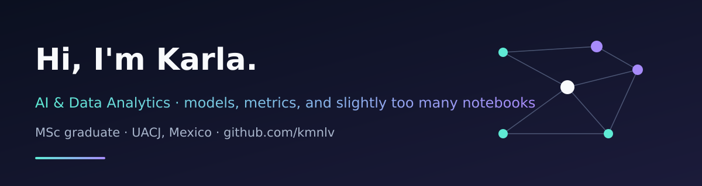

> **The short pitch:** I build models that survive contact with production — then write down how they behave so the next person can trust them.

## Hola, I'm Karla 👋

Mechatronics engineer (Universidad de Sonora, 2024), AI Software Engineer working on industrial computer vision and anomaly detection, and an **MSc candidate** in AI and Data Analytics at UACJ. Based in Hermosillo, Mexico, with English as my daily professional language.

By day I work on production inference systems: PyTorch models (autoencoders, ViT, U-Net, transfer learning), FastAPI services, MLflow tracking, image streams from industrial vision sources, and the service-level details that make latency predictable. One middleware redesign took a manufacturing inference pipeline from about **240 ms to 47 ms**.

Alongside my production work, this account is a focused portfolio of **19 public projects**, each with its own English README and enough context to re-run the interesting parts. My thesis looks at forecasting and early warning on the Tennessee Eastman Process, and a first-author paper on sliding-window evaluation bias was accepted at **CILOG 2026**.

## What I actually do

- **Make messy data behave.** Missing values, odd formats, suspicious columns — I enjoy the detail work most people skip.
- **Ship models, not just notebooks.** Production CV and anomaly detection, ONNX exports, monitoring and traceability across services.
- **Build models that can be checked.** Baselines first, leakage-free splits, metrics with their caveats attached.
- **Explain the result.** If I can't say *why* a number moved, the number doesn't count.
- **Keep one foot in engineering.** A mechatronics and embedded-verification background (RTOS, STM32, C/Python) made me care about timing and failure modes long before I cared about accuracy.

## A few projects you might like

| Project | What it is |
|---|---|
| [Tennessee Eastman forecasting](https://github.com/kmnlv/lstm-tep-scrap-forecasting) | Thesis: LSTM forecasting, run-aware splits, robustness and an audited report |
| [Traffic accident severity](https://github.com/kmnlv/traffic-accident-severity-classification) | INEGI ATUS 2024, descriptive analysis and severity classification |
| [SBERT + t-SNE clustering](https://github.com/kmnlv/sbert-embeddings-tsne-clustering) | 148 Spanish sentences, multilingual embeddings, K-Means and a FastText report |
| [CycleGAN with frozen VGG16](https://github.com/kmnlv/cyclegan-unpaired-image-translation) | Unpaired image translation, plus the written report |
| [IMDB RNN bake-off](https://github.com/kmnlv/imdb-rnn-sentiment-comparison) | SimpleRNN vs LSTM vs GRU, and a transfer-learning report |
| [Seoul bike demand](https://github.com/kmnlv/regression-bike-demand-analysis) | OLS inference, polynomial selection, best-subset search and a paper audit |
| [Research & writing](https://github.com/kmnlv/research-and-writing) | Eleven AI-ethics essays, an LLM literature review and NLP handouts |

Browse [all repositories](https://github.com/kmnlv?tab=repositories) — roughly in semester 1 → 3 order, which is also the order in which I learned all of this.

## Tools I reach for

`Python` · `PyTorch` · `PyTorch Lightning` · `ONNX` · `FastAPI` · `MLflow` · `PostgreSQL` · `scikit-learn` · `TensorFlow/Keras` · `JavaScript/React` · `AWS` · `Linux` · `Git` · `Jupyter`

## How I work (a tiny manifesto)

- A baseline is not a formality; it's the plot twist you compare everything against.
- If a metric improves, I want to know which split made it happen.
- A notebook is a hypothesis; a service is a promise.
- Notebooks are for thinking, READMEs are for other humans.
- I polish figures until each one says exactly one thing.

## Still curious about

Closing the gap between research code and production ML — MLOps maturity, system design and better SQL. Also: forecasting with uncertainty that doesn't pretend to be certain, and evaluation plots that don't flatter the model.

## Say hi

I'm on GitHub as **[@kmnlv](https://github.com/kmnlv)**. Interested in ML/data problems where research rigor and production engineering meet. Star a repo if it helped you, open an issue if something looks odd, or just browse around — the notebooks are labelled and safe to clone.

Built with ☕, PyTorch, and a lot of well-organised notebooks.

